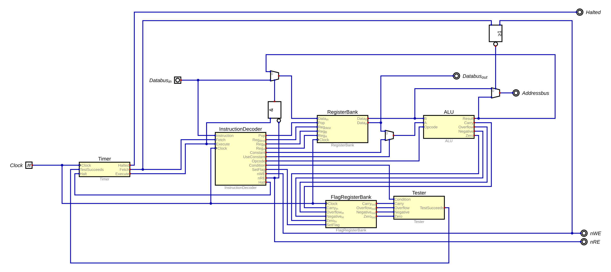

# RUNCPU: a 32-bit CPU in Digital

Created with Novi Liuther for the Processors course (2022) of the Computing Science bachelor at Radboud University. The circuits are drawn and simulated in [Digital](https://github.com/hneemann/Digital), a free logic simulator, so the `.dig` files only open there.



## Design

The CPU talks to memory through a 32-bit address bus, separate 32-bit data buses in and out, and active-low read and write enables (`nRE`, `nWE`). Every instruction is 32 bits and carries a 4-bit condition code, so any instruction can be executed conditionally, as on ARM.

An instruction takes two clock cycles and moves through four phases, one per clock edge: **Fetch** (load the instruction at the program counter and add 4 to it), **Test** (check the condition against the flags), **Execute** and **Pause**. If the condition fails, the CPU goes straight back to Fetch, so a skipped instruction takes one cycle.

| Circuit | Role |
| --- | --- |
| `CPU.dig` | Main circuit: connects the blocks below to the buses |
| `Timer.dig`, `TimerTransitions.dig` | State machine for the four phases, plus a Halted state |
| `InstructionDecoder.dig` | Holds the instruction register and turns each instruction into control signals |
| `RegisterBank.dig`, `RegSP.dig` | Sixteen 32-bit registers: `R0` always reads 0, `R14` is the stack pointer and `R15` the program counter |
| `ALU.dig` | ADD, SUB, AND, OR, XOR, AND NOT and rotate left, producing the negative, zero, carry and overflow flags |
| `FlagRegisterBank.dig` | Stores the flags; only instructions with the set-flags bit update them |
| `Tester.dig` | Decides whether the condition holds: EQ, NE, CS, CC, MI, PL, VS, VC, HI, LS, GE, LT, GT, LE, always or never |

Besides ALU operations, which take a register or a 10-bit signed constant as operand, the instruction set has `LOADHI` (loads a 22-bit constant into the upper bits of a register), `READ`, `WRITE`, `PUSH`, `POP` and `HALT`. An invalid instruction halts the CPU.

## Fixes after the course

Two bugs in `InstructionDecoder.dig` were fixed after the course:

- `PUSH` now subtracts 4 from the stack pointer and stores the register at the new address. Before, the −4 constant never reached the ALU, so `PUSH` added the pushed register to the stack pointer instead.
- `LOADHI` no longer stops the simulation with a short-circuit error when the low 8 bits of its constant are not zero (`POP R14` hit the same error). Three demultiplexers had their unused output wired to a Ground part; those parts are gone.

## Running it

Install [Digital](https://github.com/hneemann/Digital/releases/latest) (it needs Java) and open `CPU.dig`. Keep all `.dig` files in one folder, because `CPU.dig` loads the others as subcircuits.

The CPU has no memory of its own: instructions and data arrive on `Databus_in`. To see it work, press F8 to run the test cases, which feed the CPU instructions and check the results. `ALU.dig`, `Timer.dig`, `TimerTransitions.dig` and `Tester.dig` have their own tests too. They also run without the GUI:

```
java -cp path/to/Digital.jar CLI test -circ CPU.dig
```
